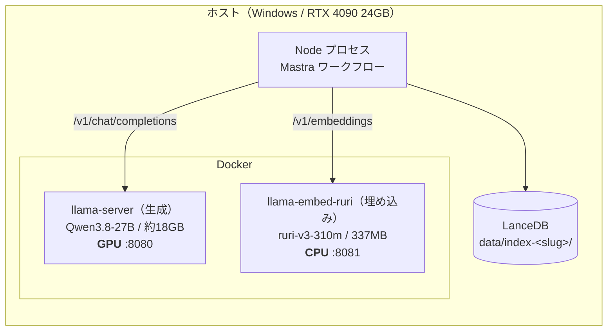

# エージェント的RAGをローカルモデルで回してみた（骨子）

> **骨子。** 章立て・図・数値表だけ。`> 書くこと:` は執筆メモなので公開時に消す。
>
> 出典: A=[`2026-08-16-cloud-multihop-instrumented`](../../experiments/2026-08-16-cloud-multihop-instrumented.md) /
> B=[`2026-08-16-local-qwen3.8-27b`](../../experiments/2026-08-16-local-qwen3.8-27b.md) /
> C=[`2026-09-02-local-emb-ruri-v3-310m-full-...`](../../experiments/2026-09-02-local-emb-ruri-v3-310m-full-naive-vs-hybrid-vs-agentic.md) /
> 埋め込み単体=[`2026-09-01-embedding-ruri-v3-310m-vs-openai`](../../experiments/2026-09-01-embedding-ruri-v3-310m-vs-openai.md) /
> 設計=[`0013`](../decisions/0013-local-llm-backend.md)・[`0014`](../decisions/0014-local-embedding-backend.md)

---

## 1. きっかけ

> 書くこと（軽めに、3〜4行）:
> - 前回記事（[エージェント的RAG vs 普通のRAG]()）で、クラウド（`gpt-5.6-luna` + `text-embedding-3-large`）で3パターンを比較した
> - 手元に RTX 4090 があるので、**同じ実験装置のモデルだけローカルに差し替えたらどうなるか**が気になった、くらいの動機
> - ちょうど日本語特化の埋め込みモデル（ruri-v3）が面白そうだったのも大きい
> - 気になっていたのは下の2つだけ。あとは見てみたら面白かったもの

**気になっていたこと**

1. **ローカルLLMでツール呼び出しはできるのか** — エージェント的RAGは `search` / `fetch` を呼んで、`scope` を選んで、4箇所でスキーマ通りのJSONを返す必要がある。27Bの量子化モデルで成立するのか
2. **768次元のローカル埋め込みで検索は落ちるのか** — 3072次元のクラウドAPIを337MBのモデルで置き換えられるのか

**やってみた結果**

| | |
|---|---|
| ツール呼び出し | **普通にできた。** 構造化出力の失敗0件、スキル選択100%、指示追従性はむしろクラウドより良い |
| ただし使い方は変わる | **fetch が 8.58 → 2.23回/問** と激減。なのに**精度は同じ**（共通24問で 15/24 の同点） |
| 埋め込み | **ハイブリッド検索では完全に同値**（65% / 83%）。純ベクトル検索だけ −8pt |
| おまけ | API課金がゼロになる代わりに、レイテンシは3〜4倍 |

> 書くこと: コードのリポジトリリンク

:::note info
コーパス・チャンク分割・golden set（46問）・プロンプト・k=5 は前回から据え置きで、**差し替えたのはモデルだけ**です。
:::

---

## 2. 使ったモデルとホスティング

| 役割 | モデル | サイズ / 次元 | 実行環境 |
|---|---|---|---|
| 生成（クラウド・前回のベースライン） | `gpt-5.6-luna` | — | OpenAI API |
| 生成（ローカル） | **Qwen3.8-27B**（unsloth GGUF `UD-Q4_K_XL`） | 約18GB | RTX 4090 / llama.cpp |
| 埋め込み（クラウド） | `text-embedding-3-large` | 3072次元 | OpenAI API |
| 埋め込み（ローカル） | **ruri-v3-310m**（Targoyle GGUF `q8_0`） | **337MB** / 768次元 | **CPU** / llama.cpp |

> 書くこと（選んだ理由は軽く）:
> - **Qwen3.8-27B**: 24GB に載る最大クラス。Q4で約18GB、KVキャッシュを q8_0 にして文脈長24576を確保した
> - **ruri-v3-310m**: 日本語 retrieval のベンチが `text-embedding-3-large` とほぼ同じ（P@1 0.555 vs 0.554）なのに337MB。**これが本当なら CPU で足りるのでは**、というのが試したかったこと。mean pooling・prefix必須（`検索クエリ: ` / `検索文書: `）
> - 思考モード（`reasoning_effort`）は最小に固定。思考トークンがレイテンシを支配すると、見たかった「ツールの使い方」が数値に埋もれるため



> 書くこと:
> - llama.cpp の公式Dockerイメージで、どちらも **OpenAI互換サーバ**として立てている。おかげでアプリ側の差し替えは接続先の分岐1箇所で済んだ
> - **埋め込みをCPUに倒したので、生成と同時に起動できる**。実測VRAM 20.4GB / 24.5GB で、埋め込みコンテナの起動ログには `no usable GPU found` と出る
> - イメージタグは固定した（`server-cuda-b10450` / CPU版は `server-b10450`）。floating なタグだと後日イメージが更新された時点で同じ実験を再現できなくなる

```yaml
# 生成（GPU / 8080）                    # 埋め込み（CPU / 8081）
- "-hf"                                 - "-hf"
- "unsloth/Qwen3.8-27B-GGUF:UD-Q4_K_XL" - "Targoyle/ruri-v3-310m-GGUF:q8_0"
- "--jinja"           # ツール呼び出しに必須
                                        - "--embeddings"  # 無いと 501
- "--chat-template-kwargs"              - "--pooling"
- '{"reasoning_effort":"low"}'          - "mean"          # 間違えてもエラーは出ない
- "-ngl" / "99"                         - "-ngl" / "0"
- "-c" / "24576"                        - "-c" / "-b" / "-ub" → すべて "8192"
- "--cache-type-k" / "-v" → "q8_0"
```

> 書くこと（余談として軽く）: ランタイムは vLLM も考えたが、unsloth の案内する経路が `NVFP4` 前提で、**これは Blackwell 世代の機能なので Ada 世代の 4090 では使えなかった**。Ollama は最短だがサンプラーと `reasoning_effort` の指定が Modelfile 経由の間接的なものになるので、フラグを直接書ける llama.cpp にした

---

## 3. ローカルLLMでツール呼び出しはできるのか

### 3.1 結論: できた

| | A: `gpt-5.6-luna` | B: Qwen3.8-27B |
|---|---|---|
| 構造化出力の失敗 | **0件** | **0件** |
| スキル選択 正解率（境界20件） | 90% | **100%** |
| search 上限超過（＝指示に従えていない回数） | 15回 | **3回** |
| search / 問 | 2.33 | **0.85** |
| fetch / 問 | 8.58 | **2.23** |
| ターン数 中央値 | 4.5 | 3 |
| 平均根拠文字数 | 4,208 | 3,598 |
| `scope`: chunk_only / with_neighbors / whole_section | 12% / 19% / **69%** | 12% / **57%** / 31% |

> 書くこと:
> - **「ローカルモデルは指示を守れない」という先入観が外れた。** 構造化出力は全問成功していて、検索回数の上限超過もスキル選択もクラウドより良い
> - 一方で**ツールの使い方はまったく違う**。fetch は1/4、ターン数中央値も 4.5 → 3

### 3.2 面白かったのは、それでも精度が同じだったこと

**共通24問で突き合わせると、両者とも 15/24（62.5%）で完全に同じ。**

| | 件数 |
|---|---|
| 両方正解 | 11 |
| クラウドのみ正解 | 4 |
| ローカルのみ正解 | 4 |
| 両方不正解 | 5 |

> 書くこと:
> - **正解数は同じなのに中身は入れ替わっている**（各4問ずつ相手の落とした問題を拾っている）。「ローカルは劣化版」ではなく**振る舞いの違うエージェント**として見た方がよさそう
> - ツール呼び出しを1/4に減らしても精度が変わらないということは、**このタスクではツールを多く呼ぶことが精度ではなかった**。クラウドは1問で8.58回 fetch して4,208文字集めていたが、**プロンプトに入るのは k=5 に切られる**ので、集めた根拠の大半は捨てられていたのだと思う
> - **`scope` の選び方が正反対**なのも面白い。クラウドは見出し単位でごっそり読み（`whole_section` 69%）、ローカルは前後1チャンクだけ足して狭く読む（`with_neighbors` 57%）。`chunk_only` は両者12%で同じなので、**「範囲を広げる」判断自体はどちらもできていて、違うのは大胆さ**だけ

:::note warn
A の agentic はレート制限（429）で2問欠損して **n=24**、B は n=26 です。
レポート上の百分率（63% vs 58%）をそのまま比べると差があるように見えるので、
母数を揃えた共通24問で突き合わせています。
:::

### 3.3 前提として、計測を先に入れておく必要があった

| 箇所 | 失敗時のフォールバック | 結果として見えるもの |
|---|---|---|
| スキル選択 | `"search"` を選ぶ | 「正しく検索を選んだ」 |
| 充足チェック | `sufficient=true` | 「1回で足りた」＝ループ不要 |
| 確信度チェック | `sufficient=true` | 「追加検索は不要だった」 |
| 質問分解 | 空配列 | 「複合質問ではなかった」 |
| `fetch` | 未知の `chunk_id` を黙って捨てる | 掴んだ事実自体が消える |

> 書くこと:
> - 上の表は**判定に失敗したときのフォールバック**で、無限ループを防ぐためのもの。個別には妥当な設計
> - ただしモデルを差し替える実験では厄介で、**ツールを使えていない状態が「ターン数中央値1、ループが働かなかった」というもっともらしい観測に化ける**
> - なので先に「ツールを何回呼んだか」「上限を超えて呼びに来たか」「構造化出力に失敗したか」を数えるようにした。**カウントはツール実装の内側**でやる（応答テキストから判定すると、呼ばずに「呼びました」と書くモデルを通してしまう）
> - 3.1 の「構造化出力の失敗0件」が確認できているから、ターン数もスキル選択精度も**フォールバックではなくモデルの判断**として読める

---

## 4. 768次元のローカル埋め込みで検索は落ちるのか

### 4.1 まず検索だけ測る

生成を挟まない検索単体の計測（数十秒で回る）。

| | `text-embedding-3-large`<br>(3072d / API) | `ruri-v3-310m`<br>(768d / CPU) | 差 |
|---|---|---|---|
| easy ベクトル検索 | 19/20 (95%) | 18/20 (90%) | −1問 |
| easy ハイブリッド | 20/20 (100%) | 20/20 (100%) | **±0** |
| multihop ベクトル検索 | 13/26 (50%) | 11/26 (42%) | −2問 |
| **multihop ハイブリッド** | 16/26 (62%) | **17/26 (65%)** | **+1問** |
| 埋め込みスループット | 56.7 件/s | 5.1 件/s（455チャンクで約1.5分） | 11倍遅い |

> 書くこと:
> - **純ベクトル検索ではクラウドAPIが勝ち、ハイブリッド（BM25+ベクトル）ではローカルが勝った。** easy でも multihop でも一貫しているのが面白い
> - 素直に解釈すると「ruri はベクトル単体の網羅性でわずかに劣るが、**BM25 と取りこぼす対象が違う**」。RRF で順位を融合するので、ベクトル側が BM25 と似すぎていると融合の旨味が減る
> - ただし26問で+1問なので、**「ローカルに落としても劣化しなかった」までが言えること**で、「ローカルの方が良い」とは言えない
> - **BM25 側は両インデックスで完全に同一の結果**だった（失敗した検索語まで同じ）。全文検索が埋め込みに依存しないことが実測で確認できた

### 4.2 3パターン比較（multihop 26問）

| | A: 全クラウド | B: 生成のみlocal | C: 全local |
|---|---|---|---|
| 生成 / 埋め込み | `gpt-5.6-luna` / 3-large | Qwen3.8-27B / 3-large | Qwen3.8-27B / **ruri-v3-310m** |
| naive（ベクトルのみ） | 50% / 73% | 50% / 73% | **42% / 71%** |
| hybrid（BM25+ベクトル） | 65% / 83% | 65% / 83% | **65% / 83%** |
| agentic（ループあり） | 63% / 75%（n=24） | 58% / 79% | **73% / 85%** |

> 書くこと（表の読み方を1段落で）:
> - **naive / hybrid は生成モデルに一切依存しない**（単発検索は決定的で、どのチャンクが入るかは埋め込みだけで決まる）。実際 A と B は26問すべてで完全に一致した。つまり**この2行で見ているのは純粋に埋め込みの差**で、動いているのは C の列だけ
> - **単発ベクトル検索は落ちたのに（50→42%）、ハイブリッドは完全に同値**（65% / 83%）。パターン2・3が使うのはハイブリッドなので、実用上は落ちていない
> - naive の −8pt は 4.1 の検索単体の計測（13/26→11/26）と完全に一致していて、**再現性のある劣化**。ここは「同程度」と言ってはいけない
> - agentic は 58% → 73%（+4問）と上がったが、**なぜかはまだ説明できていない**。仮説は「BM25 と取りこぼす対象が違うぶん、ターンをまたいで検索するパターン3では候補の多様性として効く」。ただし26問で+4問なので**ノイズと区別できる差ではない**

### 4.3 静かに壊れるのが怖かった話

> 書くこと（短く）:
> - 3072次元と768次元なら LanceDB が次元不一致で落としてくれる。でも**次元が同じで中身が違うベクトル空間は検索が成功してしまう。** 5件返ってきて、それらしい回答も生成されて、recall だけが静かに落ちる
> - なのでインデックスを埋め込みごとに物理的に分けて（`data/index-<slug>/`）、`index-meta.json` に指紋（モデル・次元・pooling・prefix）を置き、テーブルを開くたびに照合して不一致なら落とすようにした
> - もう1つは**L2正規化**。LanceDB の既定距離は L2 で、単位ベクトルなら順位は cos と一致する。llama-server には `--embd-normalize` が無く、pooling によっては非正規化ベクトルを返すので、そのまま引くと「**意味の近さではなくベクトルの長さ（≒トークン数）**」が順位を支配してしまう。これも検索は成功するので気づけない
> - 実際には ruri は llama.cpp 側で既に正規化済みだった（生ノルム 1.0000）が、確かめるまで分からなかった

---

## 5. スパイス: レイテンシとコスト

| multihop 26問 | A: 全クラウド | B: 生成のみlocal | C: 全local |
|---|---|---|---|
| naive | 3.6秒 | 14.4秒 | 14.4秒 |
| hybrid | 4.0秒 | 14.3秒 | 13.5秒 |
| agentic | 36.7秒 | 126.2秒 | 108.7秒 |
| agentic トークン in / out | 64,019 / 2,395 | 30,483 / 4,790 | 30,636 / 4,366 |
| 総実行時間 | 18.9分（並列2） | 69.0分（直列） | 79.2分（46問・直列） |
| API課金 | あり | あり（埋め込み） | **なし** |

> 書くこと:
> - **レイテンシは3〜4倍。** agentic の108秒はチャットUIでは厳しい
> - 入力トークンは半減（会話が短い）、出力トークンは倍増（思考トークンが乗る）
> - **両方ローカルにすると OpenAI への呼び出しはゼロ**になる。採点はLLMを使わない決定的な関数なので、比較実験がまるごとキー無しで回る
> - **埋め込みだけローカルにするのが一番おいしいかもしれない。** CPUで回ってGPUを取り合わず、ハイブリッドの recall は同値。ただしクエリ1本の埋め込みレイテンシは今回分離できていない（上表は生成込み）

**おまけ: easy（単発で引ける20問）でのエージェントのコスト**

| easy (20問) | 完全ヒット | 平均レイテンシ | 平均入力トークン | 平均chunk数 / 根拠文字数 |
|---|---|---|---|---|
| hybrid | **100%** | 6.0秒 | 1,507 | 5.0 / 2,536 |
| agentic | 90% | **43.2秒（7.2倍）** | **11,608（7.7倍）** | **2.5 / 1,453** |

> 書くこと: **7倍のコストを払って10pt悪化している。** 原因は根拠の絞り込みで、agentic の根拠は hybrid の半分近くしかない。単発で引ける質問に「もう十分」と早期に打ち切って、k=5 の枠を使い切っていない。前回記事の結論（easy ではエージェント化が報われない）がローカルでも再現した形

---

## 6. ハマったところ

| # | 症状 | 原因と対処 |
|---|---|---|
| 1 | tool call が一切解釈されない | `--jinja` 未指定。モデル同梱のチャットテンプレートが使われていなかった。**今回の主題そのものが成立しなくなる** |
| 2 | 全リクエストが 500 | `reasoning_effort: "none"` を渡していた。unsloth のドキュメントは none を挙げているが、**この GGUF 同梱のテンプレートは `xhigh`/`medium`/`low` しか受け付けない** → `low` に |
| 3 | `--chat-template-kwargs` の JSON が壊れる | Compose の `command` を文字列で書くと shlex で分割されクォートが剥がれる。**リスト形式で書く** |
| 4 | 埋め込みだけ起動したつもりが18GBの生成モデルまで起動 | `docker compose --profile ruri up -d` は**プロファイルを持たないサービスも対象に入る** |
| 5 | 生成を止めたつもりが全部落ちる | プロファイル指定なしの `docker compose down` はプロジェクト全体を落とす |
| 6 | `input is too large to process` | 埋め込みは非causalで**1系列が丸ごと physical batch に載る必要がある**。`-c = -b = -ub` に揃える |
| 7 | 起動が終わらない（約19分） | 17.5GB の GGUF をバインドマウント経由で読むため。埋め込み側は29秒 |

> 書くこと: **モデルの性能を見る前に、サーバが正しい設定で立っているかの方が難関だった**、というのが正直なところ。特に1と2は事前チェック（`npm run verify-local-llm`）で本番実行の前に見つかったので助かった。ローカルの比較実験は1回79分かかるので、最後に「ツール呼び出しが一度も成立していなかった」と分かるのが一番きつい

---

## 7. まとめと、正直なところ

> 書くこと（まとめ。軽く3行）:
> - **ローカル27Bでツール呼び出しは普通にできた。** むしろ指示追従性は良かった
> - **ツールの使い方は大きく変わるが、精度は変わらなかった。** k=5 の上限がある以上、たくさん呼ぶことは精度ではなかった
> - **337MBの日本語特化埋め込みは、ハイブリッド検索なら3072次元のAPIと同値。** 純ベクトルだけ少し落ちる

> 書くこと（正直なところ。隠さずに）:
> - **分散を測っていない。** agentic は `--temp 0.7` で1回の実行がサンプル1つなので、63 / 58 / 73% の ±7pt が誤差の範囲かどうか確認できていない。naive / hybrid は決定的なので **agentic だけ n=5 くらい回せば済む**話で、次にやるならここ（前回記事から持ち越している宿題でもある）
> - **回答品質は測っていない。** 採点は「正解チャンクがプロンプトに入ったか」だけなので、**ローカル27Bが同等の回答文を書けるかは未測定**。「性能は同程度」ではなく「**検索が正解を引く能力は同程度**」という話
> - ツール使用の数値を B と C で直接比較していないのは、C が46問（easy含む）・B が26問（multihopのみ）で母集団が違うため
> - コーパスは自分のQiita記事20本 / 455チャンクで、話題も vLLM・ローカルLLM・RAG構築に偏っている

> 書くこと（感想。箇条書きで素直に）:
> - 「ローカルモデルは指示を守れない」と思っていたので、そこが外れたのが一番の収穫
> - **337MB の埋め込みモデルが CPU で3072次元のクラウドAPIと戦えるのは素直に驚いた。** 埋め込みだけローカルに寄せるのは十分実用的だと思う
> - ツールをたくさん呼ぶエージェントの方が賢く見えるが、**k=5 で切られる以上それは精度ではなかった**
> - 環境構築が一番大変だった
