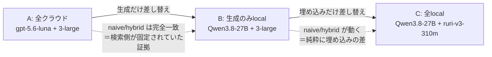
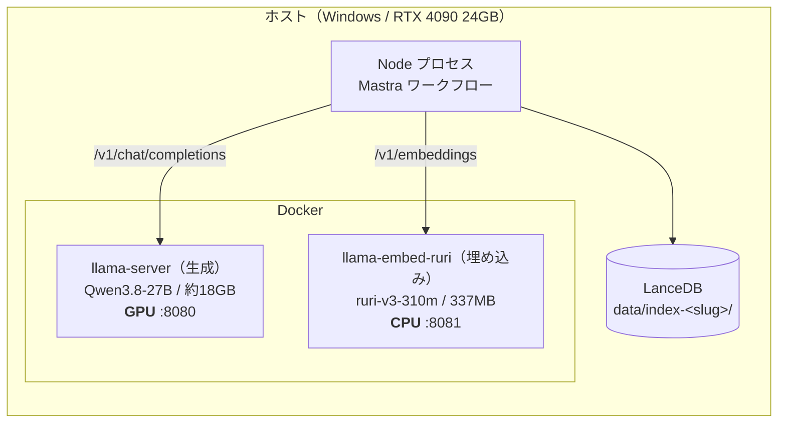
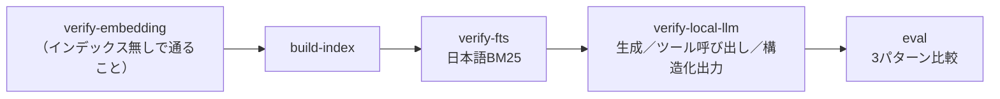

# エージェント的RAGをローカルモデルだけで回してみた（骨子）

> **骨子。** 章立て・図・数値表だけ。`> 書くこと:` は執筆メモなので公開時に消す。
>
> 出典: A=[`2026-08-16-cloud-multihop-instrumented`](../../experiments/2026-08-16-cloud-multihop-instrumented.md) /
> B=[`2026-08-16-local-qwen3.8-27b`](../../experiments/2026-08-16-local-qwen3.8-27b.md) /
> C=[`2026-09-02-local-emb-ruri-v3-310m-full-...`](../../experiments/2026-09-02-local-emb-ruri-v3-310m-full-naive-vs-hybrid-vs-agentic.md) /
> 埋め込み単体=[`2026-09-01-embedding-ruri-v3-310m-vs-openai`](../../experiments/2026-09-01-embedding-ruri-v3-310m-vs-openai.md) /
> 設計=[`0013`](../decisions/0013-local-llm-backend.md)・[`0014`](../decisions/0014-local-embedding-backend.md)

---

## 1. はじめに

> 書くこと:
> - 前回記事（[エージェント的RAG vs 普通のRAG]()）の続編。前回はクラウド（`gpt-5.6-luna` + `text-embedding-3-large`）で3パターンを比較し、**検索器の改善は効いた / エージェント化はmultihopでのみ効いた（トークン27倍）**という結論だった
> - 今回は**同じ実験装置のモデルだけを差し替える**。コーパス・チャンク分割・golden set・プロンプト・k=5 は据え置き
> - 問いは3つ: ①ローカルモデルでエージェント的RAGは成立するか ②768次元の日本語特化埋め込みは3072次元のAPIに対して retrieval をどこまで保てるか ③API課金ゼロで回るか

### 先に結論

| 問い | 結果 |
|---|---|
| ローカル27Bでツール呼び出し・構造化出力は成立するか | **成立した**（構造化出力の失敗 0件 / スキル選択 100% / 指示追従性はむしろ良い） |
| ツールの使い方は変わるか | **激減した**（fetch 8.58 → 2.23回/問）が、**精度は落ちなかった**（共通24問で 15/24 の同点） |
| 768次元のローカル埋め込みで検索は落ちるか | **ハイブリッドでは完全に同値**（65% / 83%）。純ベクトル検索だけ −8pt |
| ローカル完結で回るか | **回る**（両バックエンドを local にすると OpenAI 呼び出しは0回） |
| 代償 | レイテンシ **3〜4倍**、埋め込みの一括投入は **11倍遅い** |
| 最大の落とし穴 | **壊れても正常に見える**（フォールバック / ベクトル空間の不一致 / 未正規化） |

> 書くこと: 山場を1つ先出しする →「**ツール呼び出しを1/4に減らしても精度が同じ**」＝ クラウド側は集めた根拠の大半を k=5 の上限で捨てていた可能性が高い。コードのリポジトリリンクも貼る

---

## 2. 実験の構成



> 書くこと:
> - `LLM_BACKEND` と `EMBEDDING_BACKEND` は**独立の環境変数**。従属させると「生成はクラウドのまま・埋め込みだけローカル」という最も素直な比較が作れなくなる。ただし運用としては**1本ずつしか動かさない**
> - golden set は作り直さない。`chunk_id` はチャンク分割からのみ決まるので埋め込みを変えても不変
> - A は「対照群として取り直したもの」。前回記事の実験にはツール使用の計測が無く、**「前」の数値が存在しなかった**
> - 採点は前回と同じく retrieval-recall（正解 chunk_id が**全件そろって**プロンプトに入ったか）と部分recall。**LLM-as-judge は使っていない**ので `JUDGE_MODEL` は「問題を作ったモデル」という意味しか持たず、これが「両方 local ならキー無しで回る」の根拠になっている

:::note warn
**「性能は同程度」と書かないこと。** 測っているのは検索が正解チャンクを引けたかだけで、
ローカル27Bが同等の回答文を書けるかは未測定。「**検索が正解を引く能力は同程度**」と限定する。
:::

---

## 3. 使ったモデル

| 役割 | モデル | サイズ / 次元 | 実行環境 | 備考 |
|---|---|---|---|---|
| 生成（クラウド） | `gpt-5.6-luna` | — | OpenAI API | 前回記事のベースライン |
| 生成（ローカル） | **Qwen3.8-27B**（unsloth GGUF `UD-Q4_K_XL`） | 約18GB | RTX 4090 / llama.cpp | `reasoning_effort: low` |
| 埋め込み（クラウド） | `text-embedding-3-large` | 3072次元 | OpenAI API | 日本語 P@1 0.554 |
| 埋め込み（ローカル） | **ruri-v3-310m**（Targoyle GGUF `q8_0`） | 337MB / 768次元 | **CPU** / llama.cpp | JMTEB 77.2（日本語SOTA） / P@1 0.555 / mean pooling・prefix必須 |
| 埋め込み（予備） | `bge-m3`（`Q8_0`） | 1024次元 | CPU / llama.cpp | 結局使わずに済んだ |

> 書くこと（選定理由）:
> - **Qwen3.8-27B**: 24GB VRAM に載る最大クラス（Q4で約18GB、KVを q8_0 にして文脈長24576を確保）。エージェント的RAGはモデルへの要求が強く（ツールを正しい引数で呼ぶ / `scope` を自分で選ぶ / 検索回数の予算を守る / 4箇所でスキーマ通りのJSONを返す）、小型モデルでは実験自体が成立しない可能性があった
> - **思考モードは最小に固定**。思考トークンがレイテンシと出力トークンを支配すると「ツール使用がどう変わったか」が数値に埋もれる
> - **ruri-v3-310m**: 日本語 retrieval でクラウドAPIと同等（P@1 0.555 vs 0.554）なのに337MBで、CPU実行が現実的。8192トークンまで扱える（本コーパスは平均412文字のチャンク）
> - **`bge-m3` を予備に置いた理由**: ruri の GGUF が「ModernBERT + SentencePiece 対応の**パッチ版** llama.cpp で変換」と明記されており、ピン留めしたイメージでロードできるか事前に分からなかった → 実測ではそのまま動いた（ModernBERT サポートが upstream に入っていた）。パッチ版は**変換時にだけ**必要だった

### 却下した候補

| 候補 | 不採用の理由 |
|---|---|
| vLLM（ランタイム） | unsloth の案内する経路が `NVFP4` 前提。**Blackwell 世代の機能で RTX 4090（Ada）では使えない** |
| Ollama（ランタイム） | 最短だが、サンプラーと `reasoning_effort` の指定が Modelfile 経由の**間接的なもの**になる。実験条件は直接フラグに書きたかった |
| Windows ビルド済みバイナリ | CUDA ランタイムDLLが別配布で展開手順を誤ると落ちる。それ以上に**イメージタグを固定すれば実行環境ごと再現できる**点で Docker が勝る |
| `Qwen3-Embedding-0.6B` | 多言語 MTEB では強いが、**日本語 Retrieval で ruri-v3-310m に約9pt 劣る** |
| `multilingual-e5-large` | `query: ` / `passage: ` という別の prefix 規約を持ち、ruri と混在させると付け間違いを誘発する |
| 大型の ruri（`ruri-v3-1b` 等） | CPU では遅すぎる。310m で既に同等なので大型化の動機がない |
| GPU 常駐の埋め込みサーバ | 24GB に18GBの生成モデルが載っている。**数百MBでも VRAM 競合の可能性を作ると生成側の再現条件が崩れる** |

---

## 4. ホスティング



> 書くこと:
> - **生成と埋め込みは同時に起動できる**（埋め込みをCPUに倒してVRAMを取り合わない）。実測 VRAM 20.4GB / 24.5GB、埋め込みコンテナの起動ログには `no usable GPU found` と出る
> - どちらも **OpenAI 互換サーバ**なので、アプリ側の差し替えは接続先の分岐1箇所で済んだ
> - イメージは `ghcr.io/ggml-org/llama.cpp:server-cuda-b10450`（生成）と `server-b10450`（埋め込み・CPU版）。**タグを固定する** — floating なタグだと後日イメージが更新された時点で過去の実験を再現できなくなる。実験リポジトリにとって「どのフラグで回したか」と同格の記録
> - 埋め込みがCUDA版でないのは、GPU予約を外すと nvidia ランタイムが `libcuda.so` を注入せず CUDA ビルドが起動できない可能性があるため。**同じビルド番号のCPUイメージ**なら再現性は保ったまま不確実性を消せる

```yaml
# 生成（GPU / 8080）              # 埋め込み（CPU / 8081）
- "-hf"                           - "-hf"
- "unsloth/Qwen3.8-27B-GGUF:UD-Q4_K_XL"
                                  - "Targoyle/ruri-v3-310m-GGUF:q8_0"
- "--jinja"          # 必須       - "--embeddings"   # 無いと501
- "--chat-template-kwargs"        - "--pooling"
- '{"reasoning_effort":"low"}'    - "mean"           # 間違えてもエラーは出ない
- "-ngl"                          - "-ngl"
- "99"                            - "0"
- "-c"                            - "-c" / "-b" / "-ub"
- "24576"                         - "8192"           # 非causal。1系列が丸ごと-ubに載る必要がある
- "--cache-type-k" / "-v"
- "q8_0"             # KV量子化は必須
```

### 踏んだ落とし穴

| # | 症状 | 原因と対処 |
|---|---|---|
| 1 | tool call が一切解釈されない | `--jinja` 未指定。モデル同梱のチャットテンプレートが使われていなかった。**実験の主題そのものが成立しなくなる** |
| 2 | 全リクエストが 500 | `reasoning_effort: "none"` を渡していた。unsloth のドキュメントは none を挙げているが、**この GGUF 同梱のテンプレートは `xhigh`/`medium`/`low` しか受け付けない** → `low` に |
| 3 | `--chat-template-kwargs` の JSON が不正になる | Compose の `command` を文字列形式で書くと shlex で分割されクォートが剥がれる。**リスト形式で書く** |
| 4 | 埋め込みだけ起動したつもりが18GBの生成モデルまで起動 | `docker compose --profile ruri up -d` は**プロファイルを持たないサービスも対象に入る**。npm scripts でサービス名を明示 |
| 5 | 生成を止めたつもりが全部落ちる | プロファイル指定なしの `docker compose down` はプロジェクト全体を落とす → `rm -sf <service>` に |
| 6 | `input is too large to process` | 埋め込みのバッチが physical batch を超えた。`-c = -b = -ub` に揃えたうえでクライアント側の `batchSize` を下げる |
| 7 | 起動が終わらない（約19分） | 17.5GB の GGUF をバインドマウント経由で読むため。`start_period` を 60m に（埋め込み側は29秒） |

```bash
npm run serve:local        # 生成（GPU/8080）      npm run serve:embed  # 埋め込み（CPU/8081）
npm run verify-local-llm   # 生成／ツール呼び出し／構造化出力の事前チェック
npm run verify-embedding   # 次元・正規化・等方性・prefix・順序保証の事前チェック
npm run build-index        # 埋め込みを変えたら必ず作り直す（別ディレクトリに作られる）
```

---

## 5. 差し替える前に計測を仕込む（この実験の本体）

> 書くこと: 記事で一番書きたい章。**「モデルを差し替える実験は、壊れても正常に見える」**

### 5.1 フォールバックが「もっともらしい正常値」に化ける

| 箇所 | 失敗時のフォールバック | 結果として見えるもの |
|---|---|---|
| スキル選択 | `"search"` を選ぶ | 「正しく検索を選んだ」 |
| 充足チェック | `sufficient=true` | 「1回で足りた」＝ループ不要 |
| 確信度チェック | `sufficient=true` | 「追加検索は不要だった」 |
| 質問分解 | 空配列 | 「複合質問ではなかった」 |
| `fetch` | 未知の `chunk_id` を黙って捨てる | 掴んだ事実自体が消える |

> 書くこと:
> - 個別には**妥当な設計**（判定失敗で無限ループさせないため）。だがモデルを差し替える実験では致命的で、ツールを使えていない状態が「**ターン数中央値1、ループが働かなかった**」というもっともらしい嘘の観測に化ける
> - そこで `ToolUseStats` で失敗を明示的に数える: 呼び出し回数 / **上限超過の回数（指示追従性）** / **`scope` の内訳（読む範囲を自分で決められているか）** / 取得済みIDの再要求 / 未解決ID / **構造化出力の失敗**
> - **カウントはツール実装の内側**で行う。応答テキストから推測すると、呼ばずに「呼びました」と書くモデルを通してしまう
> - 未解決IDは**存在しないIDと予算切れの合算**なので、ハルシネーションと断定してはいけない

:::note warn
`structuredOutputFailures` が0でない実験結果は、ターン数分布もスキル選択精度も
「モデルの判断」ではなく「**フォールバックの結果**」を測っている。数値を読む前に必ずここを見る。
:::

### 5.2 埋め込み側の静かな破滅

> 書くこと:
> - 3072次元と768次元なら LanceDB が次元不一致で落としてくれる。しかし**次元が同じで意味が違うベクトル空間**は検索が成功し、5件返り、それらしい回答が生成される。**recall だけが静かに落ちる**
> - 対策は二重: ①インデックスを物理的に分ける（`data/index-<slug>/`） ②`index-meta.json`（モデル・次元・pooling・prefix・FTSトークナイザの指紋）を照合し、不一致なら日本語で throw。sidecar は手で書き換えられるので、**次元だけは実テーブルの `vector` 列から実測**して二段構え
> - 意図的に壊して3通りとも throw することを確認済み（未構築 / メタ書き換え / メタ削除）
> - **L2正規化を自前でやる**: LanceDB の既定距離は L2 で、単位ベクトルなら順位は cos と一致する。llama-server には `--embd-normalize` が無く、pooling によっては非正規化ベクトルを返す → そのまま引くと「意味的な近さ」ではなく「**ベクトルの長さ（≒トークン数）**」が順位を支配する。それでも5件返って回答も出るので、レポートに嘘の数値が並ぶ
>   - `.distanceType("cosine")` にする案を採らなかったのは、順位は同じでも**正規化バグを隠してしまう**から

### 5.3 事前チェックをゲートにする



> 書くこと:
> - **`verify-embedding` は `build-index` の前に、インデックス無しで通ることを設計原則にした。** インデックスに依存させると「壊れた埋め込みでインデックスを作ってから壊れていると分かる」順序になり、ゲートとして機能しない
> - ローカルの比較実験は1回79分。その最後に「実はツール呼び出しが一度も成立していなかった」と分かるのが最悪で、しかも**結果は一見まともに見える**
> - ツール呼び出しの判定は**`execute` が実際に走ったか**で行う。正規化の検査は `embed.ts` を経由せず**生 fetch でサーバを叩く**（自分がかけた正規化のせいで必ず1になり同義反復になる）。順序保証は**必ずバッチ境界を跨ぐ本数**で測る

`verify-embedding` の実測値（ruri-v3-310m）:

| 項目 | 結果 |
|---|---|
| 次元 / 決定性 | 768（設定と一致） / 同一文2回の cos = 1.000000 |
| 正規化 | サーバの生ノルム = 1.0000（**llama.cpp 側で既に正規化済みだった**） |
| 等方性（ベクトル崩壊） | 無関係20文の総当たり cos 平均 0.7470 / 最大 0.8281（崩壊なし） |
| prefix 適用 | query と document の cos = 0.9950（別ベクトルになっている） |
| `embedBatch` 順序保証 | 19本（バッチサイズ8を跨ぐ）全件が入力順に対応 |
| 実コーパス retrieval | 30問 / プール120件で top-3 命中率 **100%**（ランダム相当 2.5%） |

> 書くこと（正直に）: **prefix の効果は測定できなかった。** 正しい prefix と誤用のどちらも100%で差が出ていない。プローブが易しすぎたためで、「prefix が無意味」の証拠にはならない

---

## 6. 結果

### 6.1 3系列（multihop 26問）

| | A: 全クラウド | B: 生成のみlocal | C: 全local |
|---|---|---|---|
| 生成 / 埋め込み | `gpt-5.6-luna` / 3-large | Qwen3.8-27B / 3-large | Qwen3.8-27B / **ruri-v3-310m** |
| naive 完全 / 部分 | 50% / 73% | 50% / 73% | **42% / 71%** |
| hybrid 完全 / 部分 | 65% / 83% | 65% / 83% | **65% / 83%** |
| agentic 完全 / 部分 | 63% / 75%（n=24） | 58% / 79% | **73% / 85%** |
| レイテンシ naive / hybrid / agentic | 3.6 / 4.0 / 36.7秒 | 14.4 / 14.3 / 126.2秒 | 14.4 / 13.5 / 108.7秒 |
| agentic トークン in / out | 64,019 / 2,395 | 30,483 / 4,790 | 30,636 / 4,366 |
| agentic LLM呼び出し | 13.7 | 9.7 | 9.5 |
| 総実行時間 | 18.9分（26問/並列2） | 69.0分（26問/直列） | 79.2分（46問/直列） |
| API課金 | あり | あり（埋め込み） | **なし** |

> 書くこと（表の読み方）:
> - **naive / hybrid は生成モデルに一切依存しない**（単発検索は決定的で、どのチャンクが入るかは埋め込みだけで決まる）。実際 A と B は**26問すべてで完全に一致**した。これは検索側が固定されていたことの直接的な裏付けでもある
> - したがってこの2行で見ているのは**純粋に埋め込みの差**で、動いているのは C の列だけ。**agentic だけが両方に依存**して 63 → 58 → 73% と振れている

:::note warn
**A の agentic はレート制限（429）で2問欠損して n=24、B と C は n=26。**
「63% vs 58%」は**母数の違いによる見かけの差**なので、百分率をそのまま比較してはいけない。
:::

### 6.2 A → B: 生成だけローカルに

**共通24問で突き合わせると、両者とも 15/24（62.5%）で完全に同じ。**

| | 件数 |
|---|---|
| 両方正解 | 11 |
| クラウドのみ正解 | 4 |
| ローカルのみ正解 | 4 |
| 両方不正解 | 5 |

| ツール使用 | A: クラウド | B: ローカル |
|---|---|---|
| search / 問 | 2.33 | **0.85** |
| fetch / 問 | 8.58 | **2.23**（3.8分の1） |
| ターン数 中央値 | 4.5 | 3 |
| 平均根拠文字数 | 4,208 | 3,598 |
| search 上限超過（指示追従性） | 15回 | **3回** |
| 構造化出力の失敗 | **0件** | **0件** |
| スキル選択 正解率（境界20件） | 90% | **100%** |
| `scope`: chunk_only / with_neighbors / whole_section | 12% / 19% / **69%** | 12% / **57%** / 31% |

> 書くこと:
> - **正解数は同じだが中身は入れ替わっている**（各4問ずつ相手の落とした問題を拾っている）。「ローカルは劣化版」ではなく**振る舞いの異なるエージェント**
> - **ツール呼び出しを1/4にしても精度が落ちていない** ＝ このタスクでは**ツール呼び出しの多さが精度に直結していなかった**。クラウドは1問あたり8.58回 fetch して4,208文字集めていたが、**プロンプトへ入るのは k=5 に切られる**ので大半が捨てられていた可能性が高い
> - **指示追従性はむしろローカルの方が良い**（上限超過 15→3回、スキル選択 90→100%）。予想と逆。ただしスキル選択は境界20件で1〜2件の差は誤差
> - **`scope` の選び方が正反対**: クラウドは見出し単位で広く読み（`whole_section` 69%）、ローカルは前後1チャンクだけ足して狭く読む（`with_neighbors` 57%）。`chunk_only` は両者12%で同じなので**「範囲を広げる」判断自体はどちらもできている**。違うのは大胆さ。**それで精度が同じなら、広く読むことの費用対効果は疑わしい**
> - コスト構造も違う: **入力トークンは半減**（会話が短い）、**出力トークンは倍増**（思考トークンが乗る）

### 6.3 B → C: 埋め込みだけローカルに

まず**生成を挟まない検索単体**（`probe:retrieval`、数十秒で回る）で測った。

| | 3-large (3072d/API) | ruri-v3-310m (768d/CPU) | 差 |
|---|---|---|---|
| easy ベクトル検索 | 19/20 (95%) | 18/20 (90%) | −1問 |
| easy ハイブリッド | 20/20 (100%) | 20/20 (100%) | **±0** |
| multihop ベクトル検索 | 13/26 (50%) | 11/26 (42%) | −2問 |
| **multihop ハイブリッド** | 16/26 (62%) | **17/26 (65%)** | **+1問** |
| 埋め込みスループット | 56.7 件/s | 5.1 件/s（455チャンクで約1.5分） | 11倍遅い |

> 書くこと:
> - full eval の前にこれを取ったので、「ローカル埋め込みで精度が落ちた、原因は埋め込みか生成か」という交絡を避けられた
> - **純ベクトルではクラウドAPIが勝ち、ハイブリッドではローカルが勝つ。** easy でも multihop でも一貫している。素直な解釈は「ruri はベクトル単体の網羅性でわずかに劣るが、**BM25 と取りこぼす対象が違う**」。RRF はベクトル側が BM25 と相関しすぎると融合の利得が小さくなる
> - ただし26問で+1問。**「劣化しなかった」までが言えることで「ローカルの方が良い」ではない**
> - **BM25 は両インデックスで完全に同一の結果**（`verify-fts` 23/25合格、失敗した検索語まで同一）。FTS が埋め込みに依存しないことが実測で確認できた。`chunk_id` も一致するので golden set はそのまま有効
> - **両方が引けなかった質問は A で6問・B で5問あり、うち4問が共通。** これらは**埋め込みを変えても解けない**質問群で、**パターン3の見せ場は埋め込みの質とは独立に存在する**（記事の主張として使える）

そのうえで full eval（6.1 の C 列）を見ると、**B との差は埋め込みだけ**なので埋め込み軸の直接比較として読める。

> 書くこと:
> - **単発ベクトル検索は劣化したのに、ループを回すパターンだけ改善した**（naive 50→42% / hybrid 65→65% / **agentic 58→73%（+4問）**）
> - naive の −8pt は事前の `probe:retrieval`（13/26→11/26）と**完全に一致**しており、**再現性のある劣化**。「同程度」とは言えない
> - hybrid の完全同値が、**「ローカルの小型埋め込みに落としても検索能力は落ちない」という主張の中で最も強い証拠**
> - agentic の +4問は**なぜそうなるのかまだ説明できていない**。仮説は「ruri の768次元空間は BM25 と取りこぼす対象が違い、ターンをまたいで検索するパターン3ではその差が候補の多様性として効く」。ただし26問で+4問、しかも `--temp 0.7` で**1回の実行はサンプル1つ**なので**ノイズと区別できる差ではない**

---

## 7. 考察

### 7.1 ツールを多く呼ぶことは、精度ではなかった

> 書くこと: fetch 8.58 → 2.23 でも精度が同じだった話。**k=5 という上限がある以上、集めすぎた根拠は捨てられる。**「たくさん検索するエージェント」を賢さの指標にしてはいけない。前回記事の「決定点の数だけ情報を失う機会が増える」と接続する

### 7.2 easy での損益分岐点

| easy (20問) | 完全ヒット | 平均レイテンシ | LLM呼び出し | 平均入力トークン | 平均chunk数 / 根拠文字数 |
|---|---|---|---|---|---|
| hybrid | **100%** | 6.0秒 | 1.0 | 1,507 | 5.0 / 2,536 |
| agentic | 90% | **43.2秒（7.2倍）** | 7.0 | **11,608（7.7倍）** | **2.5 / 1,453** |

> 書くこと:
> - **7倍のコストを払って10pt悪化している。** 原因は根拠の絞り込みで、agentic の根拠は hybrid の**半分近くしかない**。単発で引ける質問に対して「もう十分」と早期に打ち切り、**k=5 の枠を使い切っていない**
> - **easy にルーティングしない仕組みがない限り、パターン3を常用する理由はない**
> - 失敗の方向が一貫している: C で agentic が勝った6件は**すべて「2つの異なる記事の設定を突き合わせる」形**（LLaVA と LLaVA-Med、Qwen3-14B と Qwen3-8B-FP8 など）で設計の狙い通り。負けた6件のうち2件は**単発で引ける質問**、残り4件も**正解チャンクが1記事内に固まっている**。つまり負けるのは「探索が足りない」ときではなく「**探索しすぎて根拠を絞りすぎる**」とき

### 7.3 ローカルにする価値はどこにあるか

> 書くこと:
> - **コスト**: API課金がゼロ。エージェントは1問で3万トークン以上使うので、実験を回数回す用途では効く
> - **レイテンシ**: naive 3.6→14.4秒、agentic 36.7→108.7秒。**チャットUIでは厳しい**
> - **埋め込みだけローカルにするのが一番筋が良さそう**。CPUで回ってGPUを取り合わず、ハイブリッドの recall は同値。ただしクエリ1本の埋め込みレイテンシは**分離できていない**（上表は生成込み）。ローカルはCPUで約50ms、APIはネットワーク往復で通常100〜300msなので**単発クエリではローカルが速い可能性がある**が、本実験では確かめられていない
> - **再現性**: イメージタグとフラグを固定すれば半年後も同じ条件で回せる。クラウドのモデルは黙って差し替わる

---

## 8. 限界とまとめ

> 書くこと（限界。隠さずに書く）:
> - **分散を測っていない（最優先の宿題）。** `--temp 0.7` で agentic は1回の実行がサンプル1つ。63 / 58 / 73% の ±7pt が、同一設定を複数回回したときの分散より大きいか確認していない。naive / hybrid は決定的なので **agentic だけ n=5 程度回せばよく安く済む**。評価データを増やすより先にやるべき。**前回記事から持ち越している宿題**でもある
> - **回答品質は測っていない。** 「性能は同程度」ではなく「**検索が正解を引く能力は同程度**」
> - **ツール使用は B と C で直接比較できない。** C は46問（easy含む）、B は26問（multihopのみ）で母集団が違う。search 0.85→0.46 / fetch 2.23→1.59 の低下は**easy が混ざった効果**とみるのが自然で、「1ターンで完結 1件→8件」も同じ。比較するなら `--difficulty=multihop` で取り直す必要がある
> - **A は2問欠損**（429）。prefix の効果も測れていない。`fetch` 未解決IDが 0.08→0.26/問 に増えているが、**存在しないIDの生成か予算切れかの内訳が未確認**（前者なら生成側の問題、後者なら根拠が増えた副作用で意味がまったく違う）
> - コーパスは自分のQiita記事20本 / 455チャンクで、話題も vLLM・ローカルLLM・RAG構築に偏っている

> 書くこと（まとめ。2〜3行）:
> - モデルを差し替える実験でいちばん先にやるべきは、**計測の仕込みと事前チェックのゲート**。差し替えてから結果を見るのでは遅い
> - 「ローカルだから劣る」ではなく「**振る舞いの異なるエージェント**」。正解数が同じでも中身は入れ替わる
> - 埋め込みのローカル化は費用対効果が良い。生成のローカル化はレイテンシとのトレードオフ

> 書くこと（感想。箇条書きで素直に）:
> - **モデルの性能より先に、サーバが正しい設定で立っているかの方が難関**だった（`--jinja` / `reasoning_effort: none` が500 / compose の command 形式）
> - 「ローカルモデルは指示を守れない」という先入観が外れたのが意外
> - **k=5 の上限がある以上、ツールをたくさん呼ぶことは精度ではなかった**というのが一番の学び
> - 337MB の埋め込みモデルが CPU で3072次元のクラウドAPIと同等に戦えるのは素直に驚いた
