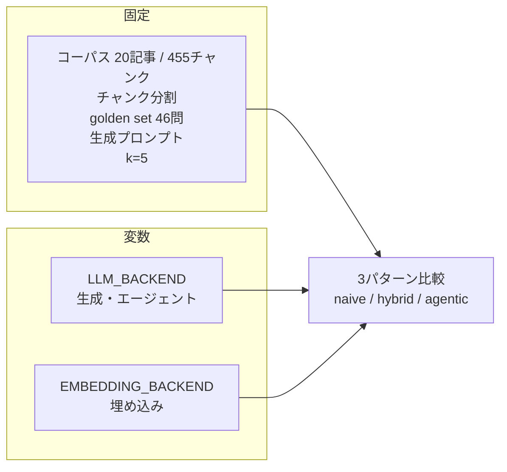
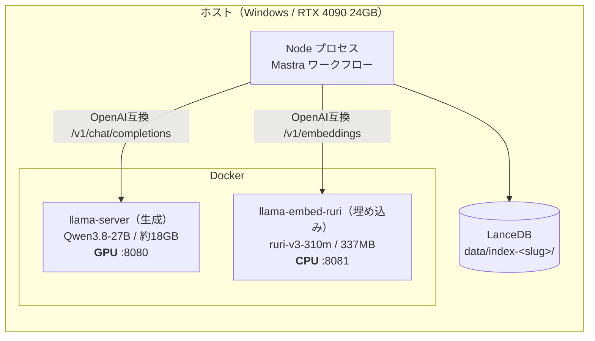
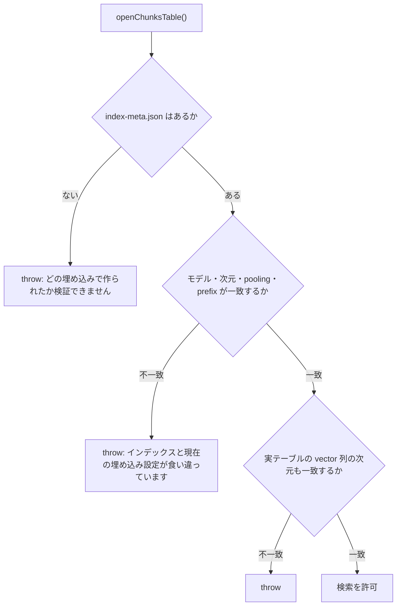
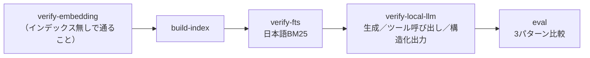
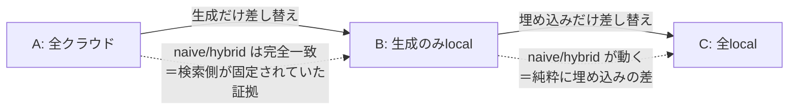

# エージェント的RAGをローカルモデルだけで回してみた（骨子）

> **これは骨子です。** 章立て・図・数値表だけを置いてあり、文章は後から埋めます。
> 各節の `> 書くこと:` は執筆メモなので、公開時には消してください。
>
> 数値の出典:
> - A: [`experiments/2026-08-16-cloud-multihop-instrumented.md`](../../experiments/2026-08-16-cloud-multihop-instrumented.md)
> - B: [`experiments/2026-08-16-local-qwen3.8-27b.md`](../../experiments/2026-08-16-local-qwen3.8-27b.md)
> - C: [`experiments/2026-09-02-local-emb-ruri-v3-310m-full-naive-vs-hybrid-vs-agentic.md`](../../experiments/2026-09-02-local-emb-ruri-v3-310m-full-naive-vs-hybrid-vs-agentic.md)
> - 埋め込み単体: [`experiments/2026-09-01-embedding-ruri-v3-310m-vs-openai.md`](../../experiments/2026-09-01-embedding-ruri-v3-310m-vs-openai.md)
> - 設計判断: [`docs/decisions/0013`](../decisions/0013-local-llm-backend.md) / [`0014`](../decisions/0014-local-embedding-backend.md)

---

## 1. はじめに

### 1.1 この記事の位置づけ

> 書くこと:
> - 前回記事（[エージェント的RAG vs 普通のRAG]()）の続きであること。前回はクラウド（`gpt-5.6-luna` + `text-embedding-3-large`）で3パターンを比較した
> - 前回の結論の1行要約: 検索器の改善（ベクトル → ハイブリッド）は明確に効いた / エージェント化はmultihopでのみ効いた（入力トークン27倍・レイテンシ9倍）
> - 今回は**同じ実験装置のモデルだけを差し替える**。コーパス・チャンク分割・golden set・プロンプト・k=5 はすべて据え置き
> - 前回記事のリンクを貼る

### 1.2 今回の問い

> 書くこと: 下記3つを一列で並べる。
>
> 1. エージェント的RAGは**ローカルモデルでも成立するのか**（ツール呼び出し・構造化出力が崩れないか）
> 2. 日本語特化の小型埋め込み（768次元）は、3072次元のクラウドAPIに対して**retrieval をどこまで保てるか**
> 3. 結果として、**API課金ゼロで同じ実験が回るのか**

### 1.3 先に結論

| 問い | 結果 |
|---|---|
| ローカル27Bでツール呼び出し・構造化出力は成立するか | **成立した**（構造化出力の失敗 0件 / スキル選択 正解率 100%） |
| ツールの使い方は変わるか | **激減した**（fetch 8.58 → 2.23回/問）が、**精度は落ちなかった**（共通24問で 15/24 対 15/24 の同点） |
| 768次元のローカル埋め込みで検索能力は落ちるか | **ハイブリッド検索では完全に同値**（65% / 83%）。純ベクトル検索だけ劣化（50% → 42%） |
| ローカル完結で回るか | **回る**。`LLM_BACKEND` と `EMBEDDING_BACKEND` の両方を local にすると OpenAI 呼び出しは0回 |
| 代償 | レイテンシ **3〜4倍**（naive 3.6秒 → 14.4秒 / agentic 36.7秒 → 108.7秒）、埋め込み投入は11倍遅い |

> 書くこと:
> - 一番おもしろかった点を1つだけ先出しする → 「**ツール呼び出しを1/4に減らしても精度が同じだった**」＝ クラウド側は集めた根拠の大半を k=5 の上限で捨てていた可能性が高い
> - コードのリポジトリリンク

---

## 2. 実験の構成

### 2.1 動かす軸は2本、ただし1本ずつ



> 書くこと:
> - `LLM_BACKEND` と `EMBEDDING_BACKEND` を**独立の環境変数**にした理由 → 従属させると「生成はクラウドのまま・埋め込みだけローカル」という最も素直な比較が作れなくなる（[`0014`](../decisions/0014-local-embedding-backend.md)）
> - 運用ルールとして**両方を同時に動かさない**。動かすと差がどちらの寄与か分離できない
> - golden set は作り直さない。`chunk_id` はチャンク分割からのみ決まるので、埋め込みを変えても不変

### 2.2 3つの系列

| | A: 全クラウド | B: 生成のみローカル | C: 全ローカル |
|---|---|---|---|
| 生成・エージェント | `gpt-5.6-luna` | **Qwen3.8-27B** | Qwen3.8-27B |
| 埋め込み | `text-embedding-3-large` (3072d) | `text-embedding-3-large` (3072d) | **ruri-v3-310m** (768d) |
| インデックス | `index-openai-3large` | `index-openai-3large` | `index-ruri-v3-310m` |
| 実施日 | 2026-08-16 | 2026-08-16 | 2026-09-02 |
| API課金 | あり | あり（埋め込みのみ） | **なし** |

> 書くこと:
> - **A → B で動くのは生成だけ、B → C で動くのは埋め込みだけ**。この差分の取り方が記事の骨格
> - A は「対照群として取り直したもの」だと明記する。前回記事の (h) 実験にはツール使用の計測が入っていないため、**「前」の数値が存在しなかった**
> - 記事の展開順は A → B → C（実際に回した順）。埋め込みを先に語る構成も考えたが、埋め込み軸の full eval は生成がローカルの状態でしか取っていないので、この順が素直

### 2.3 採点方法（前回から変更なし）

> 書くこと:
> - 主指標は retrieval-recall（**正解 chunk_id が全件そろってプロンプトに入ったか**、0 or 1）と部分recall
> - **LLM-as-judge は使っていない。** 採点は `evals/scorers/` の決定的な関数2つだけ
> - したがって `JUDGE_MODEL` は採点に使われておらず、**golden set を作ったモデル**という意味しか持たない。作り直すとものさしが変わるのでクラウド固定
> - この事実のおかげで「両方 local ならキー無しで回る」が成立する

:::note warn
**「性能は同程度」と書かないこと。** 測っているのは検索が正解チャンクを引けたかだけで、
**ローカル27Bがクラウドと同等の回答文を書けるかは未測定**。「検索が正解を引く能力は同程度」と限定する。
:::

---

## 3. 使ったモデル

### 3.1 一覧

| 役割 | モデル | サイズ / 次元 | 実行環境 | 備考 |
|---|---|---|---|---|
| 生成（クラウド） | `gpt-5.6-luna` | — | OpenAI API | 前回記事のベースライン |
| 生成（ローカル） | **Qwen3.8-27B** (unsloth GGUF `UD-Q4_K_XL`) | 約18GB | RTX 4090 / llama.cpp | `reasoning_effort: low` |
| 埋め込み（クラウド） | `text-embedding-3-large` | 3072次元 | OpenAI API | 日本語 P@1 0.554 |
| 埋め込み（ローカル） | **ruri-v3-310m** (Targoyle GGUF `q8_0`) | 337MB / 768次元 | **CPU** / llama.cpp | JMTEB 77.2（日本語SOTA）/ P@1 0.555 |
| 埋め込み（予備） | `bge-m3` (`Q8_0`) | 1024次元 | CPU / llama.cpp | 結局使わなかった |

### 3.2 生成モデルに Qwen3.8-27B を選んだ理由

> 書くこと:
> - 24GB VRAM に載る最大クラス。Q4量子化で約18GB、KVキャッシュを q8_0 にして文脈長24576を確保
> - エージェント的RAGはモデルに対して要求が強い（下記4つ）ので、小型モデルでは実験自体が成立しない可能性があった
>   1. `search` / `fetch` を正しい引数で呼ぶ
>   2. `fetch` の `scope` を自分で選ぶ
>   3. 検索回数の予算を守る
>   4. スキル選択・充足チェック・確信度チェック・質問分解で**スキーマ通りのJSON**を返す
> - 思考モード（`reasoning_effort`）は最小に固定。思考トークンがレイテンシと出力トークンを支配すると「ツール使用がどう変わったか」が数値に埋もれるため

### 3.3 埋め込みに ruri-v3-310m を選んだ理由

| モデル | 次元 | 日本語 retrieval | pooling / prefix |
|---|---|---|---|
| `text-embedding-3-large`（クラウド既定） | 3072 | P@1 0.554 | — |
| **`ruri-v3-310m`**（ローカル既定） | 768 | **JMTEB 77.2 / P@1 0.555** | mean / `検索クエリ: ` `検索文書: ` |
| `bge-m3`（フォールバック） | 1024 | P@1 0.541 | cls / なし |

> 書くこと:
> - **日本語 retrieval でクラウドAPIと同等**でありながら 310M パラメータ・337MB。CPU 実行が現実的
> - 8192トークンまで扱える（本コーパスは平均412文字のチャンクなので十分すぎる）
> - `bge-m3` を残したのは、ruri の GGUF が「**ModernBERT + SentencePiece 対応のパッチ版 llama.cpp で変換**」と明記されており、ピン留めしたイメージでロードできるか事前に分からなかったため
>   - → 実測ではそのままロードできた（ModernBERT サポートが upstream に入っていた）。パッチ版は**変換時にだけ**必要だった

### 3.4 却下した候補

| 候補 | 不採用の理由 |
|---|---|
| vLLM（ランタイム） | unsloth の案内する経路が `NVFP4` 前提。NVFP4 は Blackwell 世代の機能で、検証機の **RTX 4090 は Ada 世代**のため使えない |
| Ollama（ランタイム） | 導入済みで最短だが、サンプラーと `reasoning_effort` の指定が Modelfile 経由の**間接的なもの**になる。思考モードを実験条件として直接フラグに書きたかった |
| Windows ビルド済みバイナリ | 動くが CUDA ランタイム DLL が別配布で、展開手順を誤ると起動時に落ちる。それ以上に**イメージタグを固定すれば実行環境ごと再現できる**という点で Docker が勝る |
| `Qwen3-Embedding-0.6B` | 多言語 MTEB では強いが、**日本語 Retrieval で ruri-v3-310m に約9pt 劣る** |
| `multilingual-e5-large` | `query: ` / `passage: ` という別の prefix 規約を持ち、ruri と混在させると付け間違いを誘発する |
| 大型の ruri（`ruri-v3-1b` 等） | CPU 実行では遅すぎる。310m で既に同等なので大型化する動機がない |
| GPU 常駐の埋め込みサーバ | 24GB に18GBの生成モデルが載っている。数百MBでも **VRAM 競合の可能性を作ると生成側の再現条件が崩れる** |

---

## 4. ホスティング

### 4.1 構成図



> 書くこと:
> - **生成と埋め込みは同時に起動できる**。埋め込みを CPU に倒しているので VRAM を取り合わない
> - 実測 VRAM 20.4GB / 24.5GB（生成モデルのみ）。埋め込みコンテナは起動ログに `no usable GPU found` と出る
> - どちらも **OpenAI 互換サーバ**なので、アプリ側の差し替えは接続先の分岐1箇所だけで済んだ

### 4.2 llama.cpp を Docker で動かす

> 書くこと:
> - イメージは `ghcr.io/ggml-org/llama.cpp:server-cuda-b10450`（生成）と `server-b10450`（埋め込み・CPU版）
> - **タグを固定する。** floating な `:server-cuda` のままだと、後日イメージが更新された時点で過去の実験を再現できなくなる。実験リポジトリにとって「どのフラグで回したか」と同格の記録
> - 埋め込み側が CUDA 版でないのは、GPU 予約を外すと nvidia ランタイムが `libcuda.so` を注入せず、CUDA ビルドが起動時にバックエンドをロードできない可能性があるため。**同じビルド番号の CPU イメージ**なら再現性は保ったまま不確実性を消せる

起動コマンド（抜粋）。

```yaml
# 生成（GPU / port 8080）
command:
  - "-hf"
  - "unsloth/Qwen3.8-27B-GGUF:UD-Q4_K_XL"
  - "--jinja"                                   # ツール呼び出しに必須
  - "--chat-template-kwargs"
  - '{"reasoning_effort":"low"}'
  - "-ngl"
  - "99"
  - "-c"
  - "24576"
  - "--cache-type-k"
  - "q8_0"                                      # 24GBに18GB載せた残りでKVを賄うため必須
  - "--cache-type-v"
  - "q8_0"
```

```yaml
# 埋め込み（CPU / port 8081）
command:
  - "-hf"
  - "Targoyle/ruri-v3-310m-GGUF:q8_0"
  - "--embeddings"                              # 付け忘れると /v1/embeddings が 501
  - "--pooling"
  - "mean"                                      # ruri v3 は mean。間違えてもエラーは出ない
  - "-ngl"
  - "0"
  - "-c"
  - "8192"
  - "-b"
  - "8192"
  - "-ub"
  - "8192"                                      # 埋め込みは非causal。1系列が丸ごと -ub に載る必要がある
```

### 4.3 ホスティングで踏んだ落とし穴

| # | 症状 | 原因と対処 |
|---|---|---|
| 1 | tool call が一切解釈されない | `--jinja` 未指定。モデル同梱のチャットテンプレートが使われていなかった。**この実験の主題そのものが成立しなくなる** |
| 2 | 全リクエストが 500 | `reasoning_effort: "none"` を渡していた。unsloth のドキュメントは none を挙げているが、**この GGUF 同梱のテンプレートは `xhigh` / `medium` / `low` しか受け付けない**。`low` に変更 |
| 3 | `--chat-template-kwargs` の JSON が不正になる | Compose の `command` を文字列形式で書いていた。Compose が shlex で分割してクォートを剥がす。**リスト形式で書く** |
| 4 | 埋め込みを起動したつもりが18GBの生成モデルまで起動する | `docker compose --profile ruri up -d` は**プロファイルを持たないサービスも対象に入る**。npm scripts でサービス名を明示 |
| 5 | 生成サーバを止めたつもりが全部落ちる | プロファイル指定なしの `docker compose down` はプロジェクト全体を落とす。`rm -sf <service>` に変更 |
| 6 | `input is too large to process` | 埋め込みのバッチが physical batch を超えた。`-c = -b = -ub` に揃えたうえでクライアント側の `batchSize` を下げる |
| 7 | 起動が終わらない（約19分） | 17.5GB の GGUF をバインドマウント経由で読むため。healthcheck の `start_period` を 60m に。埋め込み側は 29秒 |

### 4.4 コマンド

```bash
npm run serve:local        # 生成サーバ起動（GPU / 8080）
npm run serve:embed        # 埋め込みサーバ起動（CPU / 8081）
npm run verify-local-llm   # 生成／ツール呼び出し／構造化出力の事前チェック
npm run verify-embedding   # 次元・正規化・等方性・prefix・順序保証の事前チェック
npm run build-index        # 埋め込みを変えたら必ず作り直す（別ディレクトリに作られる）
```

---

## 5. 計測を先に入れる（この実験の本体）

> 書くこと: ここが記事で一番書きたい章。**「モデルを差し替える実験は、壊れても正常に見える」**という話。

### 5.1 フォールバックが「もっともらしい正常値」に化ける

| 箇所 | 失敗時のフォールバック | 結果として見えるもの |
|---|---|---|
| スキル選択 | `"search"` を選ぶ | 「正しく検索を選んだ」 |
| 充足チェック | `sufficient=true` | 「1回で足りた」＝ ループ不要 |
| 確信度チェック | `sufficient=true` | 「追加検索は不要だった」 |
| 質問分解 | 空配列 | 「複合質問ではなかった」 |
| `fetch` | 未知の `chunk_id` を黙って捨てる | 掴んだ事実自体が消える |

> 書くこと:
> - これらは個別には**妥当な設計**（判定失敗で無限ループさせないため）。しかしモデルを差し替える実験では致命的になる
> - ツールを使えていない状態が「**ターン数中央値1、ループが働かなかった**」という、もっともらしい嘘の観測に化ける
> - そこで `ToolUseStats` を追加して失敗を明示的に数えるようにした。**カウントはツール実装の内側**で行う（応答テキストから推測すると、呼ばずに「呼びました」と書くモデルを通してしまう）

計測項目:

- `searchToolCalls` / `fetchToolCalls` … 実際の呼び出し回数
- `searchBlockedCalls` … 回数上限を超えて呼びに来た回数（**指示追従性**）
- `fetchScopes` … `chunk_only` / `with_neighbors` / `whole_section` の内訳（**読む範囲を自分で決められているか**）
- `fetchNoOpCalls` … 取得済みIDの再要求
- `fetchUnresolvedIds` … 本文が返らなかったID数（**存在しないIDと予算切れの合算**。ハルシネーションと断定してはいけない）
- `structuredOutputFailures` … 構造化出力の失敗回数

:::note warn
`structuredOutputFailures` が0でない実験結果は、ターン数分布もスキル選択精度も
「モデルの判断」ではなく「**フォールバックの結果**」を測っている。数値を読む前に必ずここを見る。
:::

### 5.2 埋め込み側の静かな破滅: 次元が同じで意味が違うベクトル空間

> 書くこと:
> - 3072次元と768次元なら LanceDB が次元不一致で落としてくれる
> - しかし**次元が同じで意味が違うベクトル空間**は検索が成功し、5件返り、それらしい回答が生成される。recall だけが静かに落ちる
> - 対策は二重
>   1. インデックスを物理的に分ける（`data/index-<プロファイルslug>/`）
>   2. `index-meta.json`（モデル・次元・pooling・prefix・FTSトークナイザ・チャンク数の指紋）を書き、テーブルを開くたびに現在の設定と突き合わせて**不一致なら日本語で throw**
> - sidecar だけでは手で書き換えられるので、**次元だけは実テーブルの `vector` 列から実測**して二段構え
> - 意図的に壊して3通りとも throw することを確認済み（未構築プロファイル / メタを書き換え / メタを削除）



### 5.3 L2正規化を自前でやる

> 書くこと:
> - LanceDB の `nearestTo()` の既定距離は **L2**。単位ベクトル同士なら L2 の順位は cos の順位と完全に一致するので、既存パイプラインはこの前提の上に立っている（OpenAI の埋め込みは正規化済み）
> - llama-server には `--embd-normalize` が無く、pooling によっては**非正規化ベクトルを返す**
> - そのまま L2 で引くと「意味的な近さ」ではなく「**ベクトルの長さ（≒トークン数）**」が順位を支配する。それでも検索は5件返り回答も生成されるので、レポートには嘘の数値が並ぶ
> - `embed.ts` でバックエンドを問わず**無条件に** L2 正規化を通す。正規化は冪等なので分岐が要らない ＝ 分岐が無い方が事故が起きない
> - `.distanceType("cosine")` にする案を採らなかった理由: 順位は同じだが**正規化バグを隠してしまう**

### 5.4 事前チェックをゲートにする



> 書くこと:
> - **`verify-embedding` は `build-index` の前に、インデックス無しで通ることを設計原則にした。** インデックスに依存させると「壊れた埋め込みでインデックスを作ってから壊れていると分かる」順序になり、ゲートとして機能しない
> - ローカルの比較実験は1回79分かかる。その最後に「実はツール呼び出しが一度も成立していなかった」と分かるのが最悪の失敗であり、しかも上記のフォールバックのせいで**結果は一見まともに見える**
> - ツール呼び出しの判定は**ツールの `execute` が実際に走ったか**で行う
> - 正規化の検査は `embed.ts` を経由せず**生 fetch でサーバを叩く**（自分がかけた正規化のせいで必ず1になり同義反復になる）
> - 順序保証の検査は `batchSize * 2 + 3` 本で行う（**必ずバッチ境界を跨ぐ本数**にしないとバグが表に出ない）

`verify-embedding` の実測値（ruri-v3-310m）:

| 項目 | 結果 |
|---|---|
| 次元 | 768（設定と一致） |
| 正規化 | サーバの生ノルム = 1.0000（**llama.cpp 側で既に正規化済みだった**） |
| 決定性 | 同一文2回の cos = 1.000000 |
| 等方性（ベクトル崩壊） | 無関係20文の総当たり cos 平均 0.7470 / 最大 0.8281（崩壊なし） |
| prefix 適用 | query と document の cos = 0.9950（別ベクトルになっている） |
| `embedBatch` 順序保証 | 19本（バッチサイズ8を跨ぐ）全件が入力順に対応 |
| 意味的サニティ | 関連 0.9507 / 無関係 0.7993 / 差 0.1513 |
| 実コーパス retrieval | 30問 / プール120件で top-3 命中率 **100%**（ランダム相当 2.5%） |

> 書くこと（正直に）:
> - **prefix の効果は測定できなかった。** 正しい prefix と誤用のどちらも top-3 命中率100%で差が出ていない。プローブが易しすぎたためで、「prefix が無意味」の証拠にはならない。宿題

---

## 6. 段階1: 生成だけローカルにする（A → B）

> 書くこと: 埋め込み・インデックスは**一切触っていない**。変数はエージェントを駆動するLLMだけ。

### 6.1 検索側が本当に固定されていたことの確認

> 書くこと:
> - naive と hybrid の retrieval-recall が **26問すべてで完全に一致**した（完全ヒット・部分recall とも）
> - 単発検索は決定的で、どのチャンクがプロンプトに入るかは埋め込みだけで決まるので、これは設計が意図どおり機能していることの直接的な裏付け
> - **以降で見える差はすべて生成モデルに由来する**、と言ってよい状態を作れた

### 6.2 結果（multihop 26問）

| | A: `gpt-5.6-luna` | B: Qwen3.8-27B |
|---|---|---|
| naive 完全ヒット / 部分recall | 50% / 73% | **50% / 73%**（完全一致） |
| hybrid 完全ヒット / 部分recall | 65% / 83% | **65% / 83%**（完全一致） |
| agentic 完全ヒット / 部分recall | 63% / 75%（n=24） | 58% / 79%（n=26） |
| 平均レイテンシ（agentic） | 36.7秒 | 126.2秒 |
| 平均トークン in / out（agentic） | 64,019 / 2,395 | 30,483 / **4,790** |
| 実行の欠損 | 2件（レート制限 429） | **0件** |

:::note warn
**A の agentic はレート制限で2問欠損して n=24、B は n=26。**
レポート上の「63% vs 58%」は**母数の違いによる見かけの差**。百分率をそのまま比較してはいけない。
:::

**共通24問だけで突き合わせた結果:**

| | 件数 |
|---|---|
| 両方正解 | 11 |
| クラウドのみ正解 | 4 |
| ローカルのみ正解 | 4 |
| 両方不正解 | 5 |
| **正解数** | **両者とも 15/24（62.5%）で完全に同じ** |

> 書くこと:
> - **正解数は同じだが中身は入れ替わっている**（各4問ずつ相手が落とした問題を拾っている）
> - つまり「ローカルは劣化版」ではなく、**振る舞いの異なるエージェント**として観察するのが正しい

### 6.3 ツールの使い方は激減した

| 項目 | A: クラウド | B: ローカル |
|---|---|---|
| search 呼び出し / 問 | 2.33 | **0.85** |
| fetch 呼び出し / 問 | 8.58 | **2.23**（3.8分の1） |
| ターン数 中央値 | 4.5 | 3 |
| 平均根拠文字数 | 4,208 | 3,598 |
| search 上限超過（指示追従性） | 15回 | **3回** |
| fetch 未解決ID | 12件 | 2件 |
| 構造化出力の失敗 | **0件** | **0件** |
| スキル選択 正解率（境界20件） | 90% | **100%** |

> 書くこと:
> - **これが今回の主要な発見。** ツール呼び出しを1/4に減らしても精度が落ちていない
> - ここから言えるのは、このタスクでは**ツール呼び出しの多さが精度に直結していなかった**ということ
> - クラウド側は1問あたり 8.58回 fetch して根拠を4,208文字集めていたが、**最終的にプロンプトへ入るのは k=5 に切られる**（不変条件4）。集めた根拠の大半が上限で捨てられていた可能性が高い
> - **指示追従性はむしろローカルの方が良かった**（上限超過 15回 → 3回、スキル選択 90% → 100%）。「ローカルモデルは指示を守れない」という予想とは逆
>   - ただしスキル選択は境界20件しかなく、1〜2件の差は誤差。過剰に読み取らない

### 6.4 `scope` の選び方が正反対

| scope | A: クラウド | B: ローカル |
|---|---|---|
| `chunk_only`（そのチャンクのみ） | 12% | 12% |
| `with_neighbors`（前後1チャンク） | 19% | **57%** |
| `whole_section`（見出し単位で全体） | **69%** | 31% |

> 書くこと:
> - 最も明確な質的差はここ。クラウドは**見出し単位で広く読む**、ローカルは**前後1チャンクだけ足して狭く読む**
> - `chunk_only` の比率は両者とも12%で同じなので、**「範囲を広げる」判断自体はどちらもできている**。違うのは広げ方の大胆さ
> - search と fetch を分離した狙い（「どこまで読むかをエージェントが決める」）は、ローカルモデルでも機能している
> - 平均根拠文字数が 4,208 → 3,598 に留まったのはこの控えめな範囲拡張の帰結。**それでも精度が同じだったのだから、`whole_section` で広く読むことの費用対効果は疑わしい**

### 6.5 コストの構造が違う

> 書くこと:
> - **入力トークンは半減**（64,019 → 30,483）。ツール呼び出しが少なくエージェントの会話が短いため
> - **出力トークンは倍増**（2,395 → 4,790）。`reasoning_effort: low` の思考トークンが乗る
> - **レイテンシは3.4倍**（36.7秒 → 126.2秒）。ただし直列実行かつローカル生成なので、クラウドとの絶対比較にはあまり意味がない（同時実行数 A=2 / B=1）

---

## 7. 段階2: 埋め込みもローカルにする（B → C）

### 7.1 まず生成を挟まずに測る

> 書くこと:
> - `probe:retrieval` は**生成を一切挟まない検索段階だけの計測**。数十秒で回り、埋め込みの差が recall にどう出るかを直接見られる
> - full eval を回す前にこれを取ったので、「ローカル埋め込みで回したら精度が落ちた、原因は埋め込みか生成か」という交絡を避けられた

| | `text-embedding-3-large`<br>(3072d / API) | `ruri-v3-310m`<br>(768d / CPU) | 差 |
|---|---|---|---|
| easy ベクトル検索 完全ヒット | 19/20 (95%) | 18/20 (90%) | −1問 |
| easy ハイブリッド 完全ヒット | 20/20 (100%) | 20/20 (100%) | **±0** |
| multihop ベクトル検索 完全ヒット | 13/26 (50%) | 11/26 (42%) | −2問 |
| **multihop ハイブリッド 完全ヒット** | 16/26 (62%) | **17/26 (65%)** | **+1問** |
| 埋め込みスループット | 56.7 件/s | 5.1 件/s（455チャンクで約1.5分） | 11倍遅い |

> 書くこと:
> - **純ベクトル検索では3072次元のクラウドAPIが勝ち、ハイブリッドでは768次元のローカルが勝った。** しかも easy でも multihop でも一貫している（ベクトル単体は常に A ≧ B、ハイブリッドは常に A ≦ B）
> - 素直な解釈: ruri はベクトル単体の網羅性でわずかに劣るが、**BM25 と取りこぼす対象が違う**。RRF は2つの順位を融合するので、ベクトル側が BM25 と相関しすぎると融合の利得が小さくなる
> - ただし26問での+1問。**「ローカルに落としても劣化しなかった」までが言えることで、「ローカルの方が良い」ではない**
> - **BM25 は両インデックスで完全に同一の結果**（`verify-fts` 23/25合格、失敗した検索語も同一）。FTS が埋め込みに依存しないことが実測で確認できた
> - `chunk_id` も一致するので golden set は埋め込みをまたいでそのまま有効

### 7.2 両方が引けなかった質問はほぼ同じ

> 書くこと:
> - multihop で両方が落とした質問は A で6問・B で5問あり、**うち4問が共通**（Vite×vLLM/Jupyter の Docker 構成、LLaVA/LLaVA-Med の学習段階、CIFAR-10 環境比較、LLaVA-Med の計算資源とモデル選択）
> - これらは**埋め込みを変えても解けない**質問群。つまり**パターン3（search/fetch ループ）の見せ場は、埋め込みの質とは独立に存在する**
> - 記事の主張として使える: 「埋め込みを良くしてもここは埋まらない」

### 7.3 full eval の結果（C: 全ローカル）

**multihop（26問・主戦場）**

| パターン | 完全ヒット | 部分recall | 平均chunk数 | 平均根拠文字数 | 平均レイテンシ | 平均トークン(in/out) | LLM呼び出し |
|---|---|---|---|---|---|---|---|
| naive | 42% | 71% | 5.0 | 2,332 | 14.4秒 | 1,389 / 591 | 1.0 |
| hybrid | 65% | 83% | 5.0 | 2,216 | 13.5秒 | 1,378 / 547 | 1.0 |
| **agentic** | **73%** | **85%** | 7.2 | 3,403 | 108.7秒 | 30,636 / 4,366 | 9.5 |

**easy（20問・対照群）**

| パターン | 完全ヒット | 部分recall | 平均chunk数 | 平均根拠文字数 | 平均レイテンシ | 平均トークン(in/out) | LLM呼び出し |
|---|---|---|---|---|---|---|---|
| naive | 90% | 90% | 5.0 | 2,494 | 5.9秒 | 1,458 / 214 | 1.0 |
| hybrid | **100%** | **100%** | 5.0 | 2,536 | 6.0秒 | 1,507 / 221 | 1.0 |
| agentic | 90% | 90% | **2.5** | **1,453** | 43.2秒（7.2倍） | 11,608（7.7倍） / 1,652 | 7.0 |

### 7.4 埋め込み軸の直接比較（B と C は生成が同一なので差は埋め込みだけ）

| multihop (26問) | B: `text-embedding-3-large` (3072d) | C: `ruri-v3-310m` (768d) | 差 |
|---|---|---|---|
| naive 完全ヒット | 50% | **42%** | −8pt（−2問） |
| naive 部分recall | 73% | 71% | −2pt |
| hybrid 完全ヒット | 65% | 65% | **±0** |
| hybrid 部分recall | 83% | 83% | **±0** |
| **agentic 完全ヒット** | 58% | **73%** | **+15pt（+4問）** |
| **agentic 部分recall** | 79% | **85%** | **+6pt** |

> 書くこと:
> - **単発ベクトル検索は劣化したのに、ループを回すパターンだけ改善した**
> - naive の 50% → 42% は事前の `probe:retrieval`（13/26 → 11/26）と**完全に一致**しており、純ベクトル検索の劣化は**再現性がある**。「同程度」とは言えない
> - hybrid は完全に同値。**「ローカルの小型埋め込みに落としても検索能力は落ちない」という主張の中で、これが最も強い証拠**
> - agentic の +4問は**なぜそうなるのかまだ説明できていない**。仮説: ruri の768次元空間は BM25 と取りこぼす対象が違い、ターンをまたいで検索するパターン3ではその差が候補の多様性として効く
> - ただし26問で+4問。**ノイズと区別できる差ではない**。`--temp 0.7` で agentic は1回の実行がサンプル1つにすぎない

---

## 8. 3系列まとめ

| multihop (26問) | A: 全クラウド | B: 生成のみlocal | C: 全local |
|---|---|---|---|
| 生成 | `gpt-5.6-luna` | Qwen3.8-27B | Qwen3.8-27B |
| 埋め込み | 3-large (3072d) | 3-large (3072d) | **ruri-v3-310m (768d)** |
| naive 完全 / 部分 | 50% / 73% | 50% / 73% | **42% / 71%** |
| hybrid 完全 / 部分 | 65% / 83% | 65% / 83% | **65% / 83%** |
| agentic 完全 / 部分 | 63% / 75%（n=24） | 58% / 79% | **73% / 85%** |
| naive レイテンシ | 3.6秒 | 14.4秒 | 14.4秒 |
| hybrid レイテンシ | 4.0秒 | 14.3秒 | 13.5秒 |
| agentic レイテンシ | 36.7秒 | 126.2秒 | 108.7秒 |
| agentic LLM呼び出し | 13.7 | 9.7 | 9.5 |
| 総実行時間 | 18.9分（26問 / 同時実行2） | 69.0分（26問 / 直列） | 79.2分（46問 / 直列） |
| API課金 | あり | あり（埋め込み） | **なし** |

### 8.1 この表の読み方



> 書くこと:
> - **naive / hybrid の retrieval-recall は生成モデルに一切依存しない。** 単発検索は決定的だから。実際 A と B は完全に一致している
> - したがってこの2行で見ているのは**純粋に埋め込みの差**であり、動いているのは C の列だけ
> - **agentic だけが両方に依存**し、63% → 58% → 73% と振れている

---

## 9. 考察

### 9.1 ツールを多く呼ぶことは、精度ではなかった

> 書くこと:
> - 6.3 の数字を引いて、fetch 8.58 → 2.23 でも精度が同じだったこと
> - **k=5 という上限がある以上、集めすぎた根拠は捨てられる**。「たくさん検索するエージェント」を賢さの指標にしてはいけない
> - 前回記事の「決定点の数だけ情報を失う機会が増える」という話と接続する

### 9.2 easy での損益分岐点

| easy (20問) | 完全ヒット | 平均レイテンシ | 平均LLM呼び出し | 平均入力トークン |
|---|---|---|---|---|
| hybrid | **100%** | 6.0秒 | 1.0 | 1,507 |
| agentic | 90% | **43.2秒（7.2倍）** | 7.0 | 11,608（7.7倍） |

> 書くこと:
> - **7倍のコストを払って10pt悪化している**
> - 原因は根拠の絞り込み。agentic の平均chunk数は 2.5・根拠文字数 1,453 と、hybrid の 5.0 / 2,536 の**半分近くしかない**
> - 単発で引ける質問に対してエージェントが「もう十分」と早期に打ち切り、**k=5 の枠を使い切っていない**
> - **easy にルーティングしない仕組みがない限り、パターン3を常用する理由はない**

### 9.3 パターン3が負けるのは「探索しすぎて根拠を絞りすぎる」とき

> 書くこと:
> - C で agentic が hybrid に勝った6件は**すべて「2つの異なる記事の設定を突き合わせる」形**（LLaVA と LLaVA-Med、Qwen3-14B と Qwen3-8B-FP8、CIFAR-10環境と vLLM環境）。1回の検索では片側しか引けない構造。設計の狙い通り
> - 負けた6件のうち2件は**単発で引ける質問**（easy バケットの悪化と同じ現象）。残り4件は multihop だが**正解チャンクが1記事内に固まっている**ものが多い
> - つまり失敗の方向が一貫している: **「探索が足りない」ときではなく「探索しすぎて根拠を絞りすぎる」とき**に負ける

### 9.4 ローカルにする価値はどこにあるか

> 書くこと（実運用の観点）:
> - **コスト**: API課金がゼロになる。エージェントは1問で3万トークン以上使うので、実験を回数回す用途では効く
> - **レイテンシ**: naive で3.6秒 → 14.4秒、agentic で36.7秒 → 108.7秒。**チャットUIでは厳しい**
> - **埋め込みだけローカルにするのは筋が良い**かもしれない。CPU で回っていて GPU を取り合わず、クエリ1本は数十ms、ハイブリッド検索の recall は同値
>   - ただしクエリ1本の埋め込みレイテンシは今回**分離できていない**（上表は生成込み）。ローカルは CPU で約50ms、OpenAI API はネットワーク往復で通常100〜300msなので**単発クエリではローカルのほうが速い可能性がある**が、本実験では確かめられていない
> - **再現性**: イメージタグとフラグを固定すれば、半年後でも同じ条件で回せる。クラウドのモデルは黙って差し替わる

---

## 10. 正直に書いておく限界

### 10.1 分散を測っていない（最優先の宿題）

> 書くこと:
> - `--temp 0.7` で回しており、**agentic は1回の実行がサンプル1つ**にすぎない
> - 63% / 58% / 73% という ±7pt 程度の振れが、同一設定を複数回回したときの分散より大きいのかどうかを**確認していない**
> - naive / hybrid は決定的なので繰り返す意味がない。**agentic だけ n=5 程度回せばよい**ので安く済む
> - 評価データを増やすより先にこれをやるほうが安く効く
> - 前回記事でも同じことを書いており、**まだ返せていない宿題**であることを正直に書く

### 10.2 回答品質は測っていない

> 書くこと:
> - 採点は retrieval-recall とスキル選択だけ。LLM-as-judge 指標は実装していない
> - **ローカル27Bが `gpt-5.6-luna` と同等の回答文を書けるかは未測定**
> - 「性能は同程度」ではなく「**検索が正解を引く能力は同程度**」と限定すること

### 10.3 ツール使用は B と C で直接比較できない

> 書くこと:
> - C は46問（easy 含む）、B は26問（multihop のみ）なので**1問あたりの平均値は母集団が違う**
> - search 0.85 → 0.46 / fetch 2.23 → 1.59 の低下は埋め込みの効果ではなく **easy が混ざったことの効果**とみるのが自然
> - ターン数分布の「1ターンで完結 1件 → 8件」も同じ理由。パターン3が怠けるようになった証拠ではない
> - 比較したいなら `--difficulty=multihop` で取り直す必要がある

### 10.4 その他

> 書くこと:
> - **A は2問欠損**（レート制限 429）。百分率をそのまま比較しない
> - **prefix の効果を測れていない**（プローブが易しすぎた）
> - `fetch` 未解決ID が 0.08/問 → 0.26/問 に増えている。**存在しないIDの生成か予算切れかの内訳が未確認**で、前者なら生成側の問題、後者なら根拠が増えたことの副作用。意味がまったく違う
> - コーパスは自分のQiita記事20本 / 455チャンクという小規模。話題も vLLM・ローカルLLM・RAG構築に偏っている

---

## 11. まとめ

| 観点 | 結果 |
|---|---|
| ローカル27Bでエージェント的RAGは成立するか | **成立する**（構造化出力の失敗0件 / スキル選択100% / 指示追従性はむしろ良い） |
| ツール呼び出しは減るか | **激減する**（fetch 1/4）。ただし**精度は落ちない** |
| 768次元のローカル埋め込みで検索は落ちるか | **ハイブリッドでは落ちない**（65% / 83% で完全同値）。純ベクトルのみ −8pt |
| API課金 | **ゼロにできる**（両バックエンドを local にすれば OpenAI 呼び出しは0回） |
| 代償 | レイテンシ 3〜4倍、埋め込み投入 11倍 |
| 最大の落とし穴 | **壊れても正常に見える**（フォールバック / ベクトル空間の不一致 / 未正規化） |

> 書くこと（実務的な結論を2〜3行で）:
> - モデルを差し替える実験でいちばん先にやるべきは、**計測の仕込みと事前チェックのゲート**。差し替えてから結果を見るのでは遅い
> - 「ローカルだから劣る」ではなく「**振る舞いの異なるエージェント**」。正解数が同じでも中身は入れ替わる
> - 埋め込みのローカル化は費用対効果が良い。生成のローカル化はレイテンシとのトレードオフ

## 12. 感想

> 書くこと（箇条書きで素直に）:
> - ホスティングまわりで時間を取られた（`--jinja` / `reasoning_effort: none` が500 / compose の command 形式）。**モデルの性能より先に、サーバが正しい設定で立っているかの方が難関**だった
> - 「ローカルモデルは指示を守れない」という先入観が外れたのが意外だった
> - ツールをたくさん呼ぶ方が賢く見えるが、**k=5 の上限がある以上それは精度ではなかった**、というのが一番の学び
> - 337MB の埋め込みモデルが CPU で3072次元のクラウドAPIと同等に戦えるのは素直に驚いた
> - 分散を測る宿題を前回から持ち越してしまっている
